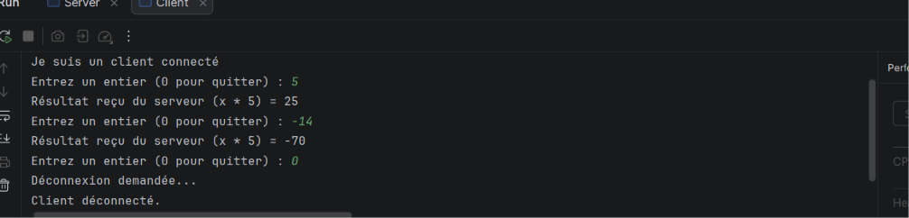

# TP1 - Architecture Réseau (Serveur / Client)

##  Interprétation des résultats de l'application Serveur

Lorsque l'on exécute la classe `Server`, la console affiche le message suivant :
> "Je suis un serveur en attente de la connexion d'un client..."

### Analyse technique :
1. **Création du `ServerSocket`** : Le serveur réserve un port d'écoute sur la machine (dans notre cas, le port `1234`).
2. **Phase de blocage (`accept`)** : L'exécution s'arrête au niveau de l'instruction `serverSocket.accept()`. Le serveur entre dans un état d'attente active (*blocking state*), guettant l'arrivée d'une requête de connexion émanant d'une application cliente.
3. **Persistance** : Tant qu'aucun client ne se connecte, la console n'affiche rien de plus. Dès qu'un client se connectera, le message *"Un client est connecté"* s'affichera avant de libérer les ressources et de fermer proprement les sockets.

##  Application Client

### 1. Code Source de la classe `Client`
Le client initialise une connexion TCP vers le serveur en précisant l'hôte (`localhost` ou `127.0.0.1`) et le port d'écoute (`1234`).

### 2. Interprétation des résultats dans la console
* **Côté Serveur** :
    1. Affiche *"Je suis un serveur en attente de la connexion d'un client..."*
    2. Dès que le client s'exécute, le serveur affiche instantanément *"Un client est connecté"*.
* **Côté Client** :
    1. Affiche *"Je suis un client pas encore connecté…"*
    2. Passe ensuite à *"Je suis un client connecté"* dès que la liaison avec le socket du serveur est établie avec succès.

### 3. Utilisation d'une adresse IP (`127.0.0.1`)
En remplaçant `"localhost"` par `"127.0.0.1"`, on cible directement l'adresse IP de loopback IPv4 de la machine locale. La connexion s'établit de la même manière.

## Exécution du Serveur
Lorsque l'on lance la classe `Server`, le programme se met en écoute sur le port `1234` :

##  Exécution du Client
Une fois le client lancé, il se connecte au serveur. Voici le résultat dans les consoles :

## Étape 2 : Service de Multiplication Réseau (Client / Serveur)

###  Fonctionnement
Dans cette étape, l'application permet une interaction en boucle :
* Le client saisit un nombre (positif, négatif ou zéro).
* Le serveur reçoit ce nombre, calcule le produit par 5 (`x * 5`) et renvoie le résultat.
* L'utilisation de `DataInputStream` et `DataOutputStream` garantit la bonne transmission des entiers, notamment les négatifs.
  
* activité 3:
* ### 1. Étape 1 : Connexion Multi-machines (LAN)
* **Configuration Serveur :** Utilisation de `InetAddress` et `InetSocketAddress` pour lier le `ServerSocket` à l'adresse IP réelle de la machine sur un port dédié (`1234`).
* **Connexion Client :** Remplacement de `localhost` par l'adresse IP de la machine serveur distante pour permettre une communication à travers un réseau local physique.

### 2. Étape 2 : Service de Calculatrice Réseau Avancé
* **Menu Interactif :** Le client dispose d'un menu affichant quatre opérations fondamentales 

* **Sérialisation des données :** Utilisation des flux binaires `DataInputStream` et `DataOutputStream` pour échanger des types précis (`int` pour les choix, `double` pour les valeurs et les résultats).
* **Gestion des Erreurs :** Contrôle de robustesse côté serveur, notamment pour la gestion et la signalisation sécurisée de la **division par zéro** (transmission d'un indicateur booléen et d'un message d'erreur textuel).
* **Fermeture Propre :** Boucle interactive (`do-while`) permettant d'enchaîner les calculs et de libérer proprement toutes les ressources réseau (sockets et flux) à la déconnexion.